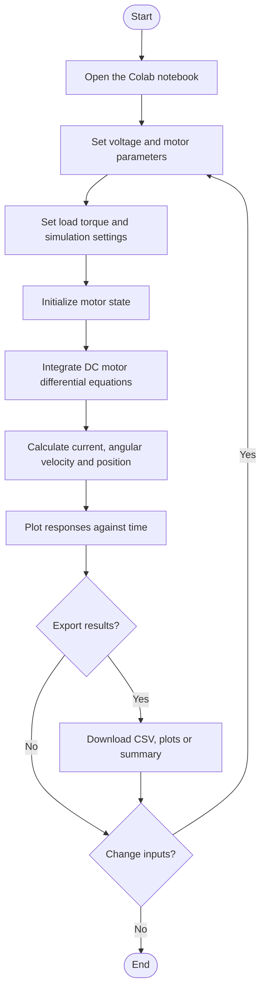

# Volt2Motion: Interactive DC Motor Modeling and Simulation

> An interactive Python-based simulator for exploring how applied armature voltage affects a DC motor's current, angular velocity, and angular position.


## Overview

**Volt2Motion** is an interactive simulation project for studying the dynamic response of a DC motor. The user supplies an armature voltage and can adjust motor parameters and load torque. The simulator plots:

- **Armature current** \(i(t)\), in amperes (A)
- **Angular velocity** \(\omega(t)\), in radians per second (rad/s)
- **Angular position** \(\theta(t)\), in radians (rad)

The project is intended for learning, experimentation, and visualization of basic DC motor dynamics. It is a mathematical simulation, not a hardware controller or a validated digital twin of a particular physical motor.

## Features

- Interactive controls for armature voltage and motor parameters
- Adjustable simulation duration and sampling resolution
- Adjustable load torque
- Time-response plots for current, angular velocity, and angular position
- CSV export and plot/report downloads, where enabled in the notebook
- Designed to run in Google Colab

> **Current model scope:** this version is an open-loop voltage-input simulation. It does not use a speed-reference feedback loop, so PID gains \(K_p\), \(K_i\), and \(K_d\) are not required. A future closed-loop extension could add P, PI, PD, and PID controllers.

## Mathematical model

### Electrical dynamics

\[
L_a \frac{di}{dt} = V_a - R_a i - K_e\omega
\]

\[
\frac{di}{dt} = \frac{V_a - R_a i - K_e\omega}{L_a}
\]

### Rotational dynamics

\[
J\frac{d\omega}{dt} = K_t i - b\omega - T_L
\]

\[
\frac{d\omega}{dt} = \frac{K_t i - b\omega - T_L}{J}
\]

### Position dynamics

\[
\frac{d\theta}{dt} = \omega
\]

| Symbol | Meaning | Typical unit |
|---|---|---|
| \(V_a\) | Applied armature voltage | V |
| \(i\) | Armature current | A |
| \(R_a\) | Armature resistance | \(\Omega\) |
| \(L_a\) | Armature inductance | H |
| \(K_e\) | Back-EMF constant | V·s/rad |
| \(K_t\) | Torque constant | N·m/A |
| \(\omega\) | Angular velocity | rad/s |
| \(\theta\) | Angular position | rad |
| \(J\) | Rotor/load inertia | kg·m² |
| \(b\) | Viscous friction coefficient | N·m·s/rad |
| \(T_L\) | Load torque | N·m |

The initial state is commonly taken as rest: \(i(0)=0\), \(\omega(0)=0\), and \(\theta(0)=0\), unless the implementation specifies otherwise.

## System flowchart



## Response graph

The figure below is a **conceptual illustration**, not a measured result from a specific motor run. Run the notebook to generate curves for your selected parameters and voltage.


### Expected qualitative behavior

- **Current:** can rise quickly after voltage is applied, then change as back EMF increases.
- **Angular velocity:** typically increases toward a steady operating speed when the motor has sufficient damping and a constant load.
- **Angular position:** is the integral of angular velocity; it continues to increase while the motor rotates in one direction.

The exact curves depend on motor parameters, load torque, applied voltage, initial conditions, and the numerical integration method.

## Technology stack

- **Python** — simulation and application logic
- **NumPy / SciPy** — numerical computation and differential-equation integration, depending on the implementation
- **Matplotlib** — response plots
- **ipywidgets** — interactive controls in Google Colab
- **Pandas** — tabular output and CSV export, if used

## Getting started

### Run in Google Colab

1. Upload `DC_Motor_Voltage_Input_GUI.ipynb` to your GitHub repository.
2. Open [Google Colab](https://colab.research.google.com/).
3. Select **File → Open notebook → GitHub** and enter your repository URL, or upload the notebook directly.
4. Run the setup/import cell first.
5. Run the GUI cell and wait for the interactive controls.
6. Adjust voltage, motor parameters, load torque, and simulation settings.
7. Click **Run** to inspect current, angular velocity, and position plots.
8. Use the notebook's export controls, if present, to save results.

### Python environment

The `.py` version is intended for an environment with the required packages. If it uses notebook-specific display or Colab download helpers, Google Colab/Jupyter is recommended.

```bash
pip install numpy scipy matplotlib ipywidgets pandas
```

## Inputs and outputs

| Type | Variables |
|---|---|
| Input | Applied armature voltage \(V_a\) |
| Adjustable parameters | \(R_a, L_a, J, b, K_t, K_e\) |
| Load disturbance | Load torque \(T_L\) |
| Output 1 | Armature current \(i(t)\) |
| Output 2 | Angular velocity \(\omega(t)\) |
| Output 3 | Angular position \(\theta(t)\) |

The exact controls depend on the notebook version you upload.

## Suggested repository structure

```text
Volt2Motion/
├── README.md
├── DC_Motor_Voltage_Input_GUI.ipynb
├── DC_Motor_Voltage_Input_GUI.py
├── volt2motion_assets/
│   └── conceptual_response.png
├── requirements.txt
└── LICENSE
```

Keep the image in `volt2motion_assets/` beside `README.md` so GitHub can display the graph. If you use a different folder name, update the image path above.

## Limitations and assumptions

- Uses a simplified lumped-parameter DC motor model.
- Does not automatically include all real-world effects, such as magnetic saturation, brush voltage drop, temperature-dependent resistance, gearbox backlash, or sensor noise.
- Results depend on selected parameters and model assumptions.
- The open-loop version does not guarantee a target speed; it shows response to applied voltage and load.
- Validate parameters against a motor datasheet or experimental measurements before using results for engineering decisions.

## Future improvements

- Add selectable P, PI, PD, and PID speed controllers.
- Compare open-loop and closed-loop responses.
- Add target-speed input and calculate rise time, settling time, overshoot, and steady-state error.
- Add voltage/current limits and anti-windup for controller experiments.
- Add example motor parameter presets.
- Validate the model against experimental data.

## Contributing

Contributions and suggestions are welcome.

1. Fork the repository.
2. Create a feature branch: `git checkout -b feature/your-feature`
3. Commit your changes.
4. Push the branch and open a pull request.

For bug reports, include parameter values, applied voltage, steps to reproduce, and any error message.

## License

Choose a license before publishing this repository. For example, the MIT License permits broad reuse with attribution. If you choose MIT, add a `LICENSE` file with the official license text. No license is implied by this README alone.

## Acknowledgements

Created as an educational project to explore DC motor dynamics, numerical simulation, and interactive engineering visualization.

---

**If you find this project useful, consider giving the repository a star ⭐ and sharing suggestions through GitHub Issues.**
